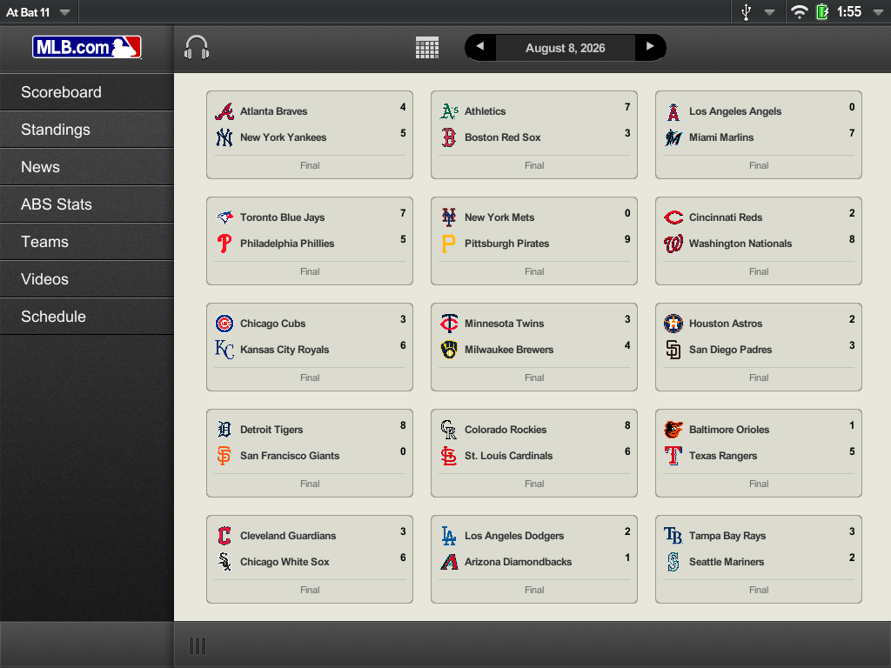
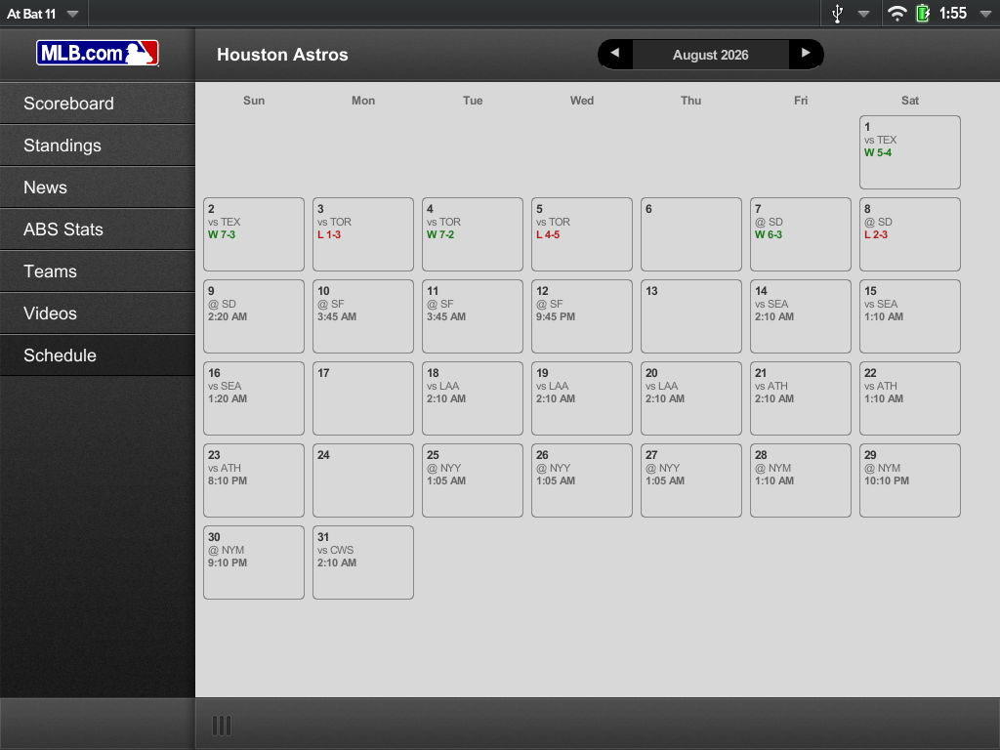

# MLB At Bat 11 — webOS Restoration

A restoration of **MLB At Bat 11**, MLB Advanced Media's official companion app for
HP's webOS 3.0.5 (HP TouchPad), for anyone still running one of these devices in
2026. The original app's backend was decommissioned years ago — every live-data
path in this restoration has been repointed at MLB's own public Stats API and
ESPN's public endpoints, and several features (Teams, Schedule, Videos, live
radio, ABS challenge review) have been added natively that the original app
never had at all.

  
  

## Features

- **Scoreboard** — every game for a given day, live score/inning status, tap
  into a live game's real-time Gameday view (linescore, pitch-by-pitch,
  matchup cards) or a completed game's full **Game Summary** (score, box
  score, top performers, highlight video, recap article, and a full
  play-by-play pane of its own).
- **Standings** — division/league standings, updated live.
- **News** — team-filterable news, rendered through a Readability-based
  in-app reader (no slow embedded browser).
- **ABS Stats** — MLB's Automated Ball-Strike challenge system: a live
  per-game tracker with full call detail (original call, overturned result,
  pitch location) for every reviewed pitch.
- **Teams** — browse any team's active roster (position players and
  pitchers side by side) and drill into a player's year-by-year stats.
- **Schedule** — any team's month-by-month schedule in a calendar view, with
  final scores (W/L) for played games and start times for upcoming ones.
- **Videos** — browse and stream recent ESPN MLB highlight clips, filterable
  by team.
- **Live radio audio** — MLB.com Audio/Gameday Audio live radio broadcasts,
  played natively through this device's own GStreamer-backed pipeline
  (bypasses this WebKit build's broken HTML5 `<audio>` support entirely).

## Requirements

- An HP TouchPad (or other webOS 3.0.5 device).
- **A device patched for TLS 1.3** — MLB's and ESPN's current APIs are
  HTTPS-only, and stock webOS 3.0.5's networking stack can't complete a
  modern TLS handshake at all without this. See
  [webOSArchive/OpenSSL-legacyWebOS](https://github.com/webosarchive) for the
  patch.
- [Preware](http://www.webos-internals.org/wiki/Preware) installed, for
  in-app update notifications to be able to install a newer release
  (optional — you can always sideload a new `.ipk` manually instead).

## Installation

Download the latest `.ipk` from this repo's
[Releases](https://github.com/alan-morford/mlbatbat11/releases) page and
install it via Preware ("Install from file") or `palm-install`.

## Updating

The app checks GitHub for a newer tagged release once per launch. If one's
available, a popup shows the changelog and — if you agree — hands the actual
download and install off to Preware.

## Architecture notes

This app is a native Enyo 1.0 (webOS's own JS application framework) app —
no PDK/native code, no embedded remote web app. Every screen fetches live
data directly from MLB's Stats API (`statsapi.mlb.com`) or ESPN's public
site API, parses it natively, and renders it with Enyo's own UI kinds. The
one exception is video playback: ESPN's clips are downloaded and transcoded
server-side (via the shared
[metube-php-servicewrapper](https://github.com/codepoet80/metube-php-servicewrapper)
instance other webOS restoration apps in this same family already use) since
this device's own H.264 decoder and on-board tooling can't handle ESPN's
delivery formats directly.

## License

Unofficial fan restoration, not affiliated with or endorsed by MLB Advanced
Media, MLB, or ESPN. Provided as-is for the webOS preservation community.
